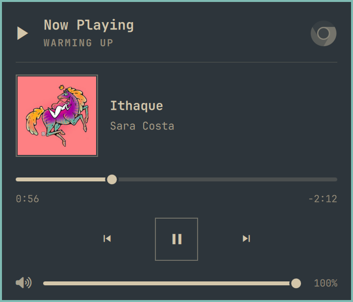
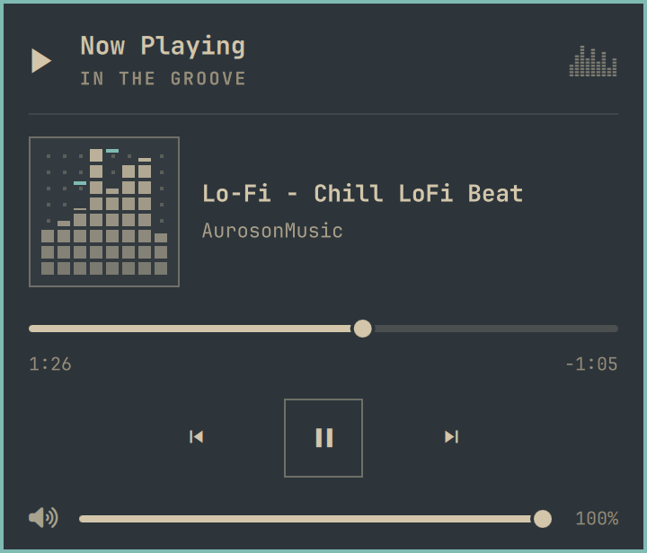
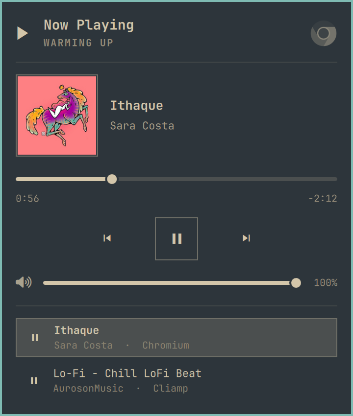
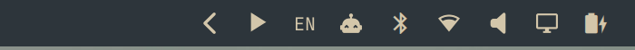

<div align="center">

# Now Playing

**A Now Playing button and popup for the [Omarchy](https://omarchy.org) bar.**

One icon in the bar. One click for everything that is playing: artwork,
timeline, transport, per-app volume and every media source on the machine.

[](https://plugins.omarchy.org)
[](https://quickshell.org)
[](https://specifications.freedesktop.org/mpris-spec/latest/)
[](#translations)
[](LICENSE)



</div>

## Features

- **One quiet icon.** ▶ while something plays, ❚❚ when nothing does. It follows
  the source that is actually sounding, so looking at another source in the
  popup never changes it.
- **Everything in one popup.** Cover art, title, artist and album; a seek bar
  with elapsed and remaining time; previous, play/pause and next; shuffle and
  repeat when the player supports them.
- **Per-app volume.** The slider drives the player's own PipeWire stream, so it
  works for browsers too, whose MPRIS volume is ignored. Your system volume is
  left alone.
- **Every source.** Spotify, cliamp, mpv, VLC, browsers, anything that speaks
  MPRIS. Rows stay in a fixed order; ▶ on a row plays that source and pauses
  the rest, so only one thing plays at a time.
- **Covers that never blink.** The next cover decodes off screen and fades in
  over the old one. The app icon Chromium serves as "art" between tracks is
  recognised and skipped.
- **An ASCII spectrum when there is no art.** An LED-style analyser fills the
  cover box, shaped by the track's name and dancing while it plays.
- **Matching app icons.** Every source icon is normalised to the same size and
  painted in your theme's colour. Click it to jump to the player's window.
- **Keyboard first.** Opens with a key and drives entirely from the keyboard.
- **Feels like Omarchy.** Built on Omarchy's own `KeyboardPanel` and
  `BarIconButton`, follows the theme live, honours `omarchy toggle animations`,
  and speaks all 50 Omarchy languages.

## Screenshots

| Artwork and controls | No artwork: ASCII spectrum |
|---|---|
|  |  |

| Several sources | In the bar |
|---|---|
|  |  |

## Install

```bash
omarchy plugin add https://github.com/ejsergeev/omarchy-now-playing.git --enable
```

Omarchy asks where on the bar to put it; the right section, next to audio,
works well. Then turn off the built-in media widget so the media keys reach
this plugin:

```bash
omarchy plugin disable omarchy.media
```

Update with `omarchy plugin update io.github.ejsergeev.now-playing`, remove with
`omarchy plugin remove io.github.ejsergeev.now-playing`.

### Requirements

Everything ships with Omarchy:

- **ImageMagick** (`magick`) normalises app icons and spots placeholder art.
  Without it, icons are shown as they are and placeholders get through.
- **`jq`, `busctl`, `hyprctl`** let a click on the source icon focus the
  player's window.

## Usage

### In the bar

| Action | Result |
|---|---|
| Left click | open the popup |
| Right click | play / pause what is playing |
| Middle click | next track |
| `Super` `Ctrl` `1…9` | open the popup by its position in the bar |

For a fixed key, add a binding to `~/.config/hypr/bindings.lua`. Keycode 58 is
`M` on any keyboard layout:

```lua
o.bind("SUPER + CTRL + code:58", "Now Playing", { panel = "io.github.ejsergeev.now-playing" })
```

### In the popup

| Key | Action |
|---|---|
| `Space` / `Enter` | play / pause (starting pauses other sources) |
| `←` / `→` (`h` / `l`) | previous / next track |
| `↑` / `↓` (`k` / `j`) | player volume ±5% |
| `,` / `.` | seek −10 s / +10 s |
| `m` | mute the player |
| `s` | shuffle |
| `r` | repeat: off → all → one |
| `Tab` / `Shift` `Tab` | next / previous source |
| `Esc` | close |

Letter keys work on Russian and other layouts too.

The source list: click a row to show that source (playback is unchanged); its
▶ plays it and pauses the others; its ❚❚ just pauses it. The popup returns to
what is playing every time it opens.

## How it works

| Piece | What it does |
|---|---|
| `Service.qml` | Tracks MPRIS players, picks the active and the playing source, answers the `media` IPC target used by the media keys. |
| `BarWidget.qml` | The bar icon and the popup. Holds metadata through the brief blanks players send between tracks, so nothing jumps. |
| `probe-art.sh` | Compares new local art with the player's own icon and rejects a near match: that is Chromium's placeholder, not a cover. |
| `app-icon.sh` | Turns any app icon into a single-colour glyph of a fixed size: brightness becomes opacity, the result is trimmed and centred. Cached in `~/.cache/omarchy-now-playing`. |
| `raise-player.sh` | Finds and focuses the player's Hyprland window when the player cannot raise itself over MPRIS. |
| `i18n/` | One catalog per Omarchy language. |

Volume goes to the player's PipeWire stream rather than MPRIS, because browsers
report an MPRIS volume they never apply.

## Translations

Strings live in `i18n/<lang>.json`, one file for each of Omarchy's 50
languages, and follow **Setup › Language** live. Shared terms (play, pause,
mute…) reuse Omarchy's own wording. The rest, including the playful names for
where a track is (*Needle drop*, *In the groove*, *Encore*), are machine
translations that native speakers have not reviewed yet. Corrections are very
welcome. Times use the language's own numerals, and right-to-left languages are
mirrored.

## Development

```bash
git clone https://github.com/ejsergeev/omarchy-now-playing.git
ln -s "$PWD/omarchy-now-playing" ~/.config/omarchy/plugins/io.github.ejsergeev.now-playing
omarchy plugin validate "$PWD/omarchy-now-playing"
omarchy plugin enable io.github.ejsergeev.now-playing
```

Edits under `~/.config/omarchy/plugins/` reload on save. If one doesn't,
run `omarchy restart shell`.

## Credits

Started from Omarchy's built-in `omarchy.media` widget, whose MPRIS service it
still builds on. Licensed under the [MIT License](LICENSE).
